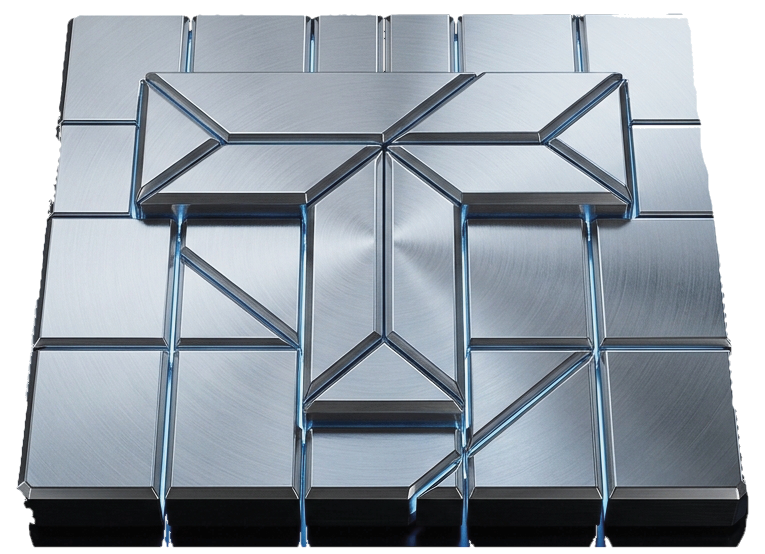

# TITANIUM — High-Performance Ataxx Engine

<div align="center">
  
  <p><em>A state-of-the-art, lightweight CPU Ataxx engine in pure Rust.</em></p>
</div>

---

**Titanium** is an open-source, high-performance Ataxx game engine written in pure Rust. Engineered for raw speed and deep tactical precision, Titanium combines a single-`u64` bitboard representation, dual-perspective NNUE neural evaluation, an auxiliary Small Net for futility bound pruning, and an alpha-beta search with Moonbird-style selectivity and Stockfish-grade mate distance pruning.

Titanium powers both native high-throughput testing harnesses, a browser-based WebAssembly interface, and competitive tournament play on [Botzone](https://www.botzone.org.cn).

---

## Key Features & Architecture

### 1. Ultra-Fast Bitboard Move Generation
- **Compact Geometry:** The 7x7 board fits inside a single 49-bit `u64` bitmask, eliminating dynamic heap allocations in hot paths.
- **Chebyshev Geometry & LUT Inversion:** Clones (Chebyshev distance 1) and jumps (distance 2) leverage precomputed shift masks and BMI2 hardware `pext` lookups for 8-neighbor infection flips.
- **Throughput:** Capable of exceeding 100M+ nodes/second in bulk bitboard perft calculations.

### 2. Dual-Perspective NNUE Neural Evaluation
- **Quantized Feature Transformer:** Int16 SIMD accumulators evaluated from the perspective of both sides, quantized (`QA`) for sub-microsecond inference directly on the CPU.
- **Incremental Accumulators:** Differential updates (`update_child`) track only modified squares during copy-make search, avoiding costly full refreshes.
- **Trained on 34M+ Positions:** Distilled and calibrated through deep alpha-beta teacher labeling, inspired by milestones from [Moonbird](https://github.com/the-spill/moonbird).

### 3. Auxiliary Small Net (Futility Pre-Filter)
- **Lower-Bound Pruning:** A lightweight secondary neural network bounds child node evaluations before invoking the primary NNUE network.
- **Zero Elo Loss:** Saves up to 49% of heavy NNUE calls in late-move futility pruning while maintaining 100% search quality.

### 4. Search & Selectivity
- **Negamax Alpha-Beta with Iterative Deepening:** Full-window Principal Variation Search (PVS) with soft/hard clock budgets.
- **Transposition Table:** 24-byte cache entries indexed by deterministic 64-bit Zobrist keys with depth-preferred replacement.
- **Selective Reductions:** Moonbird 1.1-style dynamic Late Move Reductions (LMR) and static eval-based Futility Reductions.
- **Stockfish/Reckless-Style Mate Distance Pruning:** Automatically halts iterative deepening the moment a shortest forced win is proven, and actively selects the deepest delaying resistance lines when defending a losing branch.
- **In-Tree Circular Move Pruning:** Clone-bounded tracking of board hashes on the active search path immediately rejects circular jump loops (`CIRCULAR_MOVE`), preventing wasted compute on graph cycles and eliminating Transposition Table Graph-History-Interaction (GHI) pollution.
- **Platform Stalemate Compliance:** Full support for standard Ataxx double-pass endings as well as Botzone's filled-count stalemate rule (mobile side absorbs remaining empty squares).

---

## Workspace Layout

```
crates/titanium        Engine core: bitboard geometry, NNUE, small net, alpha-beta search
crates/titanium-ffi    C-ABI shared library (libtitanium_ffi.so / .dll) for Botzone & interop
crates/titanium-cli    Native CLI test harness: bench, perft, match, selfplay, labelbin
crates/titanium-wasm   WebAssembly bindings via wasm-bindgen for web play
botzone/               Botzone deployment package (Python 3 driver + glibc 2.14 Linux .so)
docs/                  Architectural specifications, community research, and persistent search design
web/                   Interactive Web GUI (Vite + vanilla JS/Canvas)
```

---

## Technical Documentation & Research

Comprehensive architecture guides and research benchmarks are organized in [`docs/`](docs/README.md):
- **[Zero-Cost PUCT Disagreement Head (`TNN3`)](docs/DISAGREEMENT_HEAD_SPEC.md):** Dual-headed NNUE with packed `ecache` for PUCT-like selectivity.
- **[Persistent Search Tree vs. One-Shot Engine on Botzone](docs/PERSISTENT_VS_ONESHOT_BOTZONE.md):** Search state preservation, TT age rotation, and fail-low refutation preservation.
- **[Community Research & Competitive Intelligence (2025–2026)](docs/COMMUNITY_RESEARCH_2026.md):** KataGo Ataxx MCTS, Monty, Mexx, and BMI2 `pext` bitboards.
- **[Experiment Ledger](LEDGER.md):** Complete gate logs from E0 baseline through S57 and Botzone Ladder matches.

---

## Quickstart & CLI Commands

Compile with cargo (AVX2 / native CPU optimizations recommended):

```sh
# Run unit & hygiene tests
cargo test --workspace

# Benchmark search speed from the standard start position
cargo run -p titanium-cli --release -- bench --max-depth 8

# Move generation perft benchmark
cargo run -p titanium-cli --release -- perft 5

# Interactive console play vs engine
cargo run -p titanium-cli --release -- play --time 1000

# Best move evaluation on a board state
cargo run -p titanium-cli --release -- bestmove "......x ....... ....... ....... ....... ....... o...... b" --time 500

# Self-play match generation
cargo run -p titanium-cli --release -- selfplay --games 20 --time 300
```

### Board String Representation
Boards are formatted as 49 characters (rows top-to-bottom, squares left-to-right) followed by the side to move (`b` for Black, `w` for White):
- `.` = Empty
- `x` = Black piece
- `o` = White piece
- `#` = Blocker / obstacle

Start position:
```
x.....o ....... ....... ....... ....... ....... o.....x b
```

---

## Botzone Competition Deployment

Titanium includes automated deployment tooling for [Botzone](https://www.botzone.org.cn):
- **C-ABI Shared Library:** Cross-compiled with Zig for `x86_64-unknown-linux-gnu` with `glibc <= 2.14` (fully compatible with Botzone's Ubuntu 16.04 sandbox).
- **Python 3 Driver:** Packaged in `botzone/upload/titanium_botzone.py` using Botzone Simple IO mode (granting the full 12s initial / 6s subsequent move thinking budgets).
- **One-Command Build:**
  ```sh
  python tools/build_botzone.py --no-pull
  ```

---

## Acknowledgments & Related Work

- **[Moonbird](https://github.com/the-spill/moonbird)** by the-spill — An exceptional Ataxx engine whose search selectivity, evaluation insights, and public milestones inspired Titanium's training and pruning architecture.
- **Stockfish & Reckless** — For foundational principles in mate distance pruning, iterative deepening bounds, and robust engine design.
